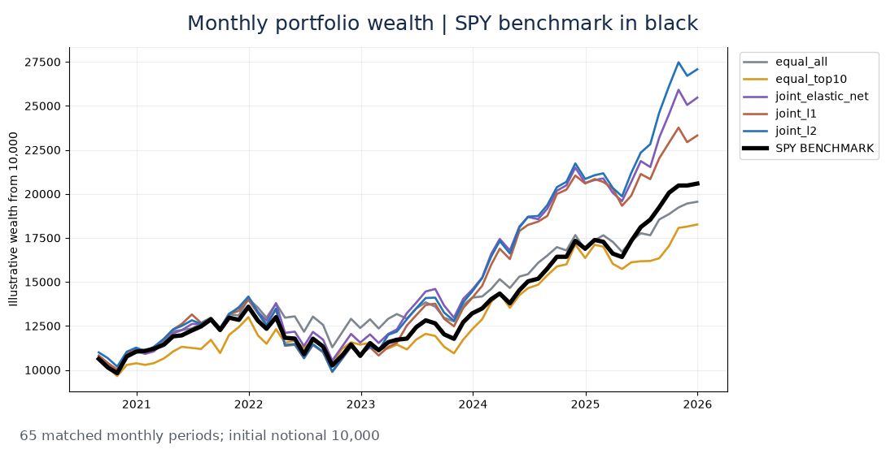
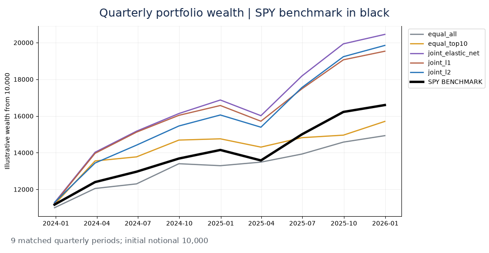
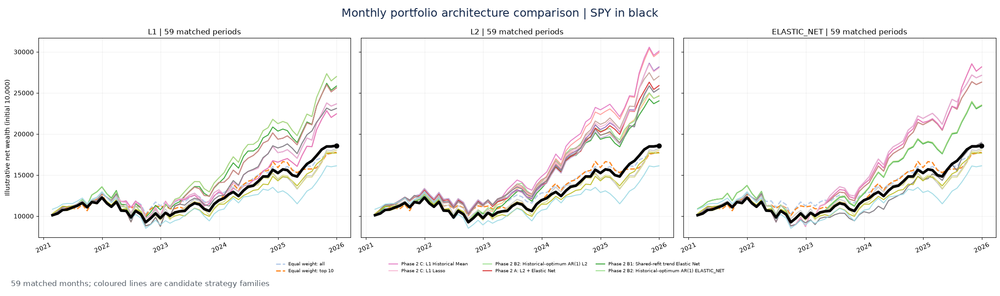
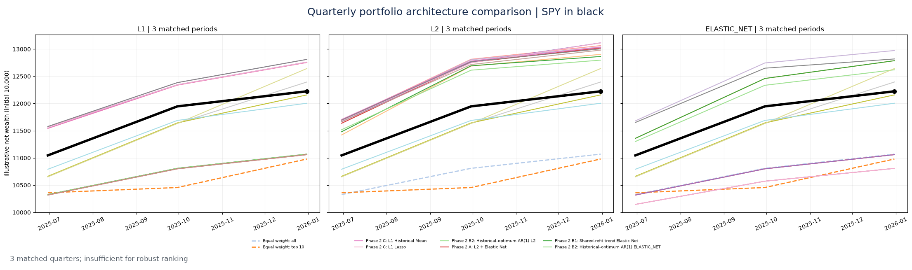

# EquityLab | Systematic Equity Research

**A public case study in portfolio construction, out-of-sample forecasting and stochastic risk.**

EquityLab examines whether historical price information, company characteristics and statistical modelling can support better equity allocation decisions. The project evaluates chronological portfolio strategies, compares them with simple investment baselines and SPY, investigates return predictability and models portfolio downside under alternative market scenarios.

The emphasis is on **research discipline rather than a claim of predictable profits**: comparable time windows, transaction costs, solver diagnostics, risk decomposition, error analysis and explicit uncertainty.

> **Research interpretation:** All reported results are exploratory historical or simulated findings. They are not live trading returns, independently certified point-in-time results, guarantees of alpha or investment advice.

## Research at a glance

| Research component | Public evidence |
| --- | --- |
| Equity selection and allocation | Equal-weight controls, regularised allocation families, SPY-matched historical scorecards |
| Selection versus weighting | Separate comparison of portfolio composition and position sizing |
| Return forecasting | Rolling, one-observation-ahead ARIMA/ARIMAX comparisons against historical-mean and zero-return baselines |
| Volatility and market dependence | Distribution diagnostics, return autocorrelation, squared-return dependence and conditional-variance models |
| Stochastic portfolio risk | Correlated geometric Brownian motion and joint historical block bootstrap |
| Data quality | Coverage audits, dated-information limitations and implementation assumptions |

## Portfolio research: matched periods

These panels are **separate samples**, not a controlled comparison of monthly versus quarterly rebalancing. The initial illustrative notional is 10,000. Estimated trading costs are incorporated in the portfolio series; they do not constitute a complete execution model.

| Allocation approach | Monthly: 65 periods | Quarterly: 9 periods |
| --- | ---: | ---: |
| SPY | 20,583 | 16,598 |
| Equal-weight universe | 19,550 | 14,929 |
| Simple ranked selection, equal-weight | 18,261 | 15,706 |
| Regularised allocation — L1 | 23,316 | 19,532 |
| **Regularised allocation — L2** | **27,074** | **19,848** |
| Regularised allocation — elastic net | 25,466 | **20,449** |

The monthly sample contains 65 holding intervals from July 2020 through December 2025; the quarterly sample contains nine from September 2023 through December 2025. See [portfolio research](docs/portfolio_research.md) for drawdown and solver-reliability context.

## Historical performance through time

The dated wealth trajectories below come directly from saved historical research figures. Portfolio holdings, security-level returns, fitted coefficients and strategy implementation are not published. **SPY is displayed in black.** Wealth is normalised to an initial 10,000 units; different samples are not directly comparable.

### Portfolio policies: 65 monthly and 9 quarterly matched periods

### Forecast-informed allocation: 59 monthly and 3 quarterly matched periods

The coloured lines reflect alternative research allocations without disclosing internal selection rules. The short quarterly test is descriptive only.

For the matching benchmark tables, see [portfolio performance and benchmarking](notebooks/01_portfolio_evidence.ipynb). These images preserve actual research curves. The public aggregate data **cannot support reconstructed period-by-period drawdowns or rolling Sharpe ratios**, so those are intentionally not simulated.

## Where does portfolio value come from?

A controlled monthly ablation shows that equal weighting among the L2 policy's ten highest-ranked holdings generated a higher historical ending notional than the policy's original position sizes, **with greater turnover**. That suggests portfolio composition mattered substantially; it does not establish that a particular weighting rule will dominate out of sample.

## Return forecasting and volatility

| Rolling SPY return test | ARIMA RMSE | Historical-mean RMSE | Observation count |
| --- | ---: | ---: | ---: |
| Monthly holdout | 0.030506 | **0.027339** | 12 months |
| Daily holdout | **0.007529** | 0.007545 | 126 trading days |

The monthly historical mean outperformed the fitted ARIMA specification. The daily difference was marginal. Squared-return dependence is more evident than ordinary return dependence in the monthly diagnostics; a conditional-variance investigation therefore complements point-return forecasting. Read [time-series research](docs/returns_and_volatility.md).

## Scenario analysis

Correlated GBM and historical block resampling evaluate hypothetical outcomes using historical calibration and fixed portfolio snapshots. These scenarios help expose tail risk and model dependence, **not** establish independent forecasting power. Read [risk and simulation](docs/stochastic_risk.md).

## Browse the evidence

- [Research design and controls](docs/methodology.md)
- [Portfolio performance, attribution and numerical reliability](docs/portfolio_research.md)
- [Return analysis and rolling forecasting](docs/returns_and_volatility.md)
- [Simulation and portfolio risk](docs/stochastic_risk.md)
- [Data provenance and coverage](docs/data_sources_and_coverage.md)
- [Limitations and responsible interpretation](docs/limitations.md)
- [Aggregate CSV tables](results/) and [self-contained public charts](figures/)
- [Portfolio performance and benchmarking](notebooks/01_portfolio_evidence.ipynb), [rolling forecasts and volatility](notebooks/02_forecasts_and_volatility.ipynb), and [stochastic scenario risk](notebooks/03_stochastic_risk.ipynb), each with a distinct focus and using **aggregate public files only**

## What is public—and what is not

The public repository contains narrative research, aggregated metrics, charts and safe aggregate-data plotting examples. It **does not distribute** private research notebooks, raw vendor data, historical security-level return panels, holdings histories, selected signals, feature transformations, trained parameters, portfolio-policy implementation, simulation engine or cache artefacts. This separation protects proprietary work and avoids redistributing restricted market data.

## Interpretation

EquityLab is an interview-focused research case study demonstrating hypothesis formation, chronological validation, portfolio construction, model diagnostics and investment risk judgement. Its results motivate further investigation, **not a live-investment recommendation**.

The information in this repository is for research communication only, not financial advice.

## Public notebook guide

| Notebook | Focus |
| --- | --- |
| [01 — Portfolio performance](notebooks/01_portfolio_evidence.ipynb) | Dated wealth charts, SPY-matched benchmarking, allocation and risk diagnostics |
| [02 — Return forecasts and volatility](notebooks/02_forecasts_and_volatility.ipynb) | One-step forecast accuracy, statistical baselines, conditional-volatility model selection |
| [03 — Stochastic scenario risk](notebooks/03_stochastic_risk.ipynb) | GBM and block-bootstrap scenario distributions, downside and benchmark risk |

Historical wealth figures are included only in Notebook 01. Return-forecast comparisons appear only in Notebook 02; scenario summaries only in Notebook 03.
