# EquityLab

**Independent quantitative investment research | Dynamic coefficient forecasting | Portfolio construction**

> **Status: ongoing research, not a live or production strategy.** This repository is a curated public portfolio of results. The data and execution assumptions are still under audit, the results are exploratory, and they do not establish reliable alpha. The coefficient-identification and allocation code remains private.

## At a glance

- **Question:** can forecasting how economic coefficients change over time build better portfolios than conventional mean-variance optimisation (MPT)?
- **Method:** a two-phase research pipeline tested on 36 monthly out-of-sample decisions, across three risk mandates, after modelled costs.
- **Finding:** the dynamic models beat conventional MPT on ending wealth in every comparison, with or without NVDA. Against MPT matched to their own risk they mostly lead, but the gap is not statistically clear. They beat SPY only with NVDA in the universe.
- **What I learned:** the most impressive headline depended on one stock, while the win over MPT did not. Forecasting added less than expected over a simple historical-mean control, and the small hand-picked universe remains the main limit on these results.

## The main result

**The main goal is to beat conventional MPT, and the dynamic models did on ending wealth in every comparison. When MPT is matched to their own risk they mostly still lead, but the gap is not statistically clear.** Beating SPY would be a bonus. That happened in one of the two Growth configurations, and it depended on NVDA.

The evaluation covers 36 monthly out-of-sample decisions from January 2023 to December 2025.

**What "12 comparisons" means:** each count below scores one dynamic model in one setup against one benchmark, over those same 36 months. There are 12 combinations:

| Choice | Options | Number |
|---|---|---:|
| Dynamic model | Hierarchical state-space, quality low-rank Kalman | 2 |
| Feature representation | Grouped, Hierarchical | 2 |
| Mandate | Growth, Balanced, Defensive | 3 |
| **Total** | 2 × 2 × 3 | **12** |

For example, "12 of 12" against MPT / Historical mean means both models finished ahead in all six representation and mandate pairs. These are not 12 independent experiments. They share the same market period and asset list, so a win count shows how consistent a result is, not how many separate confirmations it has.

**Main goal: beat MPT**

| Dynamic models against | Higher ending wealth | Higher Sharpe | Monthly gap clearly above zero |
|---|---:|---:|---:|
| MPT / Historical mean | **12 of 12** | **8 of 12** | 3 of 12 |
| MPT / Shrinkage | **12 of 12** | **12 of 12** | 6 of 12 |
| MPT matched to the control's estimated risk† | **10 of 12** | **10 of 12** | 1 of 12 |
| MPT matched to each model's own estimated risk | **8 of 9** | **5 of 9** | 0 of 9 |

The last row is the direct test. Three of the 12 paths are incomplete because the solver failed in up to three months, so they are not counted. MPT still had lower realised volatility in all nine complete comparisons, and no gap is clearly above zero, so **H1 is promising but not established**.

**Bonus: beat passive investing**

Each mandate is judged against the benchmark that suits its risk level. Each row has 4 comparisons: 2 models × 2 representations.

| Mandate | Benchmark | Dynamic models above it |
|---|---|---:|
| Growth | SPY | **2 of 4** |
| Balanced | SPY/T-bill blend | **0 of 4** |
| Defensive | SPY/T-bill blend | **2 of 4** |

After adjusting for SPY exposure, none of the 12 dynamic results has a 95% interval above zero, so none can be statistically separated from market exposure.

**Removing NVDA**

The whole pipeline was rerun without NVDA, using the same code on the other 43 instruments. This changes the picture in two opposite ways, shown in the [charts below](#results-without-nvda).

| Dynamic models above | With NVDA | Without NVDA |
|---|---:|---:|
| MPT / Historical mean | 12 of 12 | **12 of 12** |
| MPT / Shrinkage | 12 of 12 | **12 of 12** |
| MPT matched to each model's own risk | 8 of 9 | **11 of 11** |
| Fair passive benchmark | 4 of 12 | **0 of 12** |
| Historical-mean control | 6 of 12 | **4 of 12** |

- **Against MPT, the result holds up.** Without NVDA the models also had the higher Sharpe in 11 of 11 own-risk comparisons, although no gap is clearly above zero (largest t = 1.93).
- **The Growth headline does not.** Grouped Growth state-space falls from 21,175 to 14,784, well below SPY's 18,516.

All of this depends on a small, fixed [asset universe](#asset-universe), which may flatter any strategy allowed to hold its strongest names.

**Does forecasting itself add value?**

Dynamic models beat the non-dynamic historical-mean control in only **6 of 12** comparisons. In other words, much of the advantage over MPT may come from the EquityLab framework rather than from forecasting coefficients over time. The control also beat both MPT variants in 6 of 6 configurations, and beat MPT matched on estimated risk in 5 of 6.

The [notebook](notebooks/01_public_readout.ipynb) recomputes these tables from the released monthly data.

## The research question

**Can dynamic economic forecasts improve investment decisions?** EquityLab has two phases. **Phase 1** identifies economic coefficients. **Phase 2** models how those coefficients change and forecasts them forward to inform constrained portfolio construction.

**The dynamic forecasting system is the intended research design.** Historical-mean coefficients (`mean`) are a non-dynamic baseline, kept to test whether forecasting adds value.

| Question | In plain English | Current status |
|---|---|---|
| **H1 — Complete system** | Does a pre-specified dynamic strategy beat conventional MPT after accounting for realised risk? This is the main goal. | **Promising, not established.** Dynamic models mostly lead MPT matched to their own risk, but the gaps are not statistically clear, and the models were chosen with hindsight. |
| **H2 — Why does it work (or not)?** | Do differences come from forecasting, asset choice, allocation or market exposure? | **Exploratory comparisons complete**; causal attribution is incomplete. |
| **H3 — Can the information help MPT?** | Does EquityLab-derived information improve a shared MPT optimiser? | **Mixed**, in a separate 27-month experiment. |

## What is being compared

| Label | Meaning | How to read it |
|---|---|---|
| **EL / Hierarchical state-space** | EquityLab with a hierarchical state-space coefficient forecast | Dynamic candidate, chosen for presentation after seeing results |
| **EL / Quality low-rank Kalman** | EquityLab with a low-rank, quality-adjusted Kalman-style forecast | Dynamic candidate, chosen the same way |
| **EL / Historical-mean coefficient control** | EquityLab allocation using average historical coefficients | Non-dynamic baseline, not the intended system. Shown as `EquityLab` in older CSV columns |
| **SPY** | S&P 500 ETF | Fully invested passive benchmark. A fair comparison for Growth, and too risky a yardstick for Balanced or Defensive |
| **T-bills** | Short-term US Treasury-bill proxy | Cash-like reference and the risk-free rate for Sharpe ratios |
| **SPY / T-bills** | Simple mandate-based mix of the two | The fair passive comparison for Balanced and Defensive |
| **MPT / Historical mean** | Mean–variance optimiser using trailing average returns (*Plain MPT* in CSVs) | Conventional comparator with no EquityLab inputs |
| **MPT / Shrinkage** | Mean–variance optimiser with expected returns pulled toward a shared average (*Corrected MPT* in CSVs) | Conventional comparator. "Corrected" refers to fixes to an earlier implementation |
| **MPT / Ex-ante risk-matched** | MPT constrained to the control's estimated volatility at each decision | Diagnostic only; equal forecast risk does not ensure equal realised risk |

**Growth, Balanced and Defensive** are separate mandates with different equity allocations. **Grouped and Hierarchical** are different feature representations, not time periods.

**How to read the charts**

- **Wealth line:** starts at an illustrative 10,000 units and compounds monthly net backtest returns.
- **Drawdown line:** percentage fall from the previous wealth peak.
- **Net:** after modelled transaction costs; market impact and other real-world costs are not established.
- **Sharpe ratio:** mean return above T-bills, scaled by the variability of that excess return.
- **Asterisk (`*`):** a model chosen for this showcase after inspecting historical results.
- **Dagger (`†`):** an MPT risk target taken from the historical-mean control.

## Results

### Dynamic models against MPT

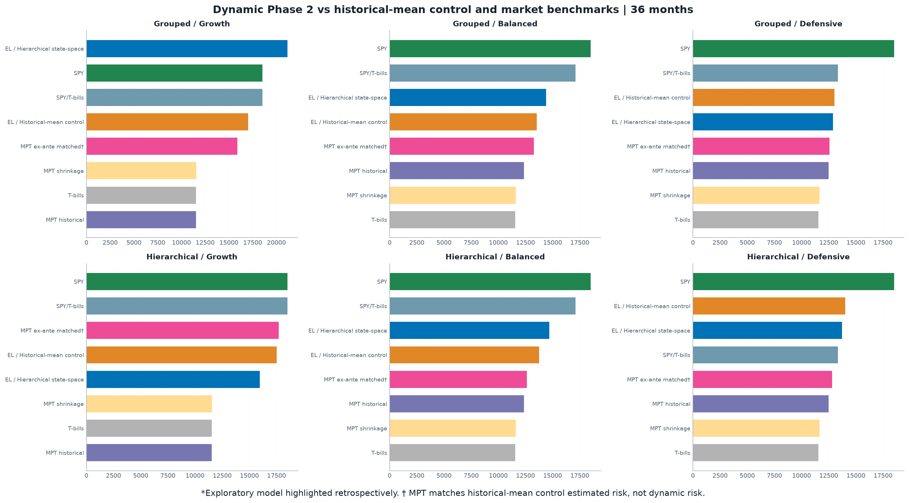

*Bars show hierarchical state-space; the table below includes both models.*

| Configuration | State-space | Low-rank Kalman | MPT / Historical mean | MPT / Shrinkage | Risk-matched MPT† |
|---|---:|---:|---:|---:|---:|
| Grouped / Growth | **21,175** | **20,209** | 11,545 | 11,568 | 15,881 |
| Grouped / Balanced | **14,405** | **14,155** | 12,358 | 11,602 | 13,267 |
| Grouped / Defensive | **12,905** | **12,932** | 12,497 | 11,657 | 12,569 |
| Hierarchical / Growth | **15,968** | **15,319** | 11,545 | 11,568 | 17,696 |
| Hierarchical / Balanced | **14,685** | **14,520** | 12,358 | 11,602 | 12,630 |
| Hierarchical / Defensive | **13,717** | **13,552** | 12,497 | 11,657 | 12,802 |

- **Conventional MPT:** both dynamic models finished ahead in all six configurations. The monthly gap is clearly above zero in 9 of those 24 comparisons, most often against MPT / Shrinkage.
- **Risk:** MPT held less equity and was less volatile, so part of this gap is risk taken rather than skill. In Growth, the dynamic models ran about 14% volatility against about 7% for conventional MPT.
- **Defensive:** MPT / Historical mean kept a higher Sharpe (1.55) than all four dynamic results, although it ended with less wealth.
- **Risk-matched MPT†:** the models finished ahead in 10 of 12 comparisons, losing both in Hierarchical Growth. This target comes from the control, not the dynamic portfolios.
- **MPT matched to each model's own risk:** this is the like-for-like test. The models finished ahead in 8 of 9 complete comparisons. Grouped Growth state-space ended at 21,175 against 20,256 for its matched MPT, which also had the higher Sharpe (1.59 against 1.50), so most of that headline result is available to plain MPT at the same risk in this universe.

### Dynamic models against passive benchmarks

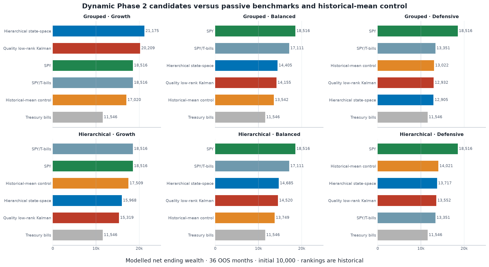

*Each panel is ranked separately by ending wealth after 36 months, from 10,000 units with modelled costs.*

- **Best result:** in Grouped Growth, hierarchical state-space ended at **21,175** and quality low-rank Kalman at **20,209**, against **18,516** for SPY and **17,020** for the historical-mean control.
- **That result took more risk:** state-space had 14.3% realised volatility against SPY's 11.9%, and a −10.0% maximum drawdown against −8.3%. Sharpe was 1.50 against 1.39.
- **It did not carry over:** in Hierarchical Growth the same model ended at **15,968** and low-rank Kalman at **15,319**, both below SPY and the control.
- **Balanced lagged:** the featured models ended between 14,155 and 14,685, against **17,111** for the SPY/T-bill blend.
- **Defensive split:** both models beat the blend's **13,351** in Hierarchical (13,717 and 13,552) and lagged it in Grouped (12,905 and 12,932).

The two models were picked for presentation from a larger candidate family after the results were known. Their out-of-sample returns are real backtest outputs, but the choice of models was not made out of sample.

<!-- FEATURED_TIME_SERIES_START -->

### Grouped Growth: monthly net wealth

Two dynamic forecasting candidates are shown; both were retrospectively selected for presentation. All curves use the same 36 monthly dates. Amounts are illustrative, with unverified historical FX provenance.

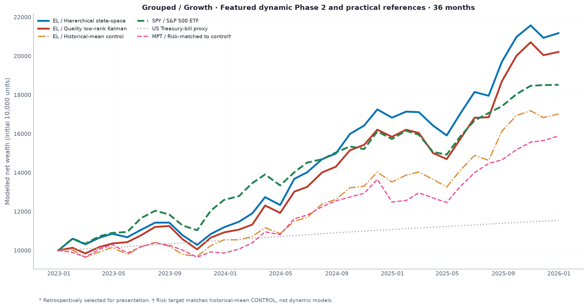

### Grouped Growth: drawdowns

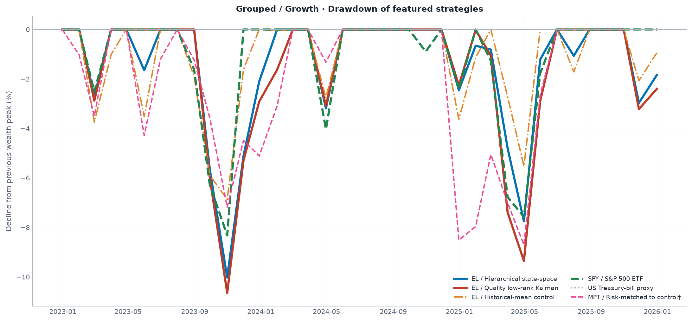

<!-- FEATURED_TIME_SERIES_END -->

<details>
<summary>All six configurations: comparison charts and table</summary>

<!-- DYNAMIC_ALL_COMPARISONS_START -->

### Dynamic model across the six selected configurations

The table shows hierarchical state-space; [the model-level CSV](results/selected_dynamic_model_summary.csv) has both candidates. These results are exploratory, not a predeclared H1 test.

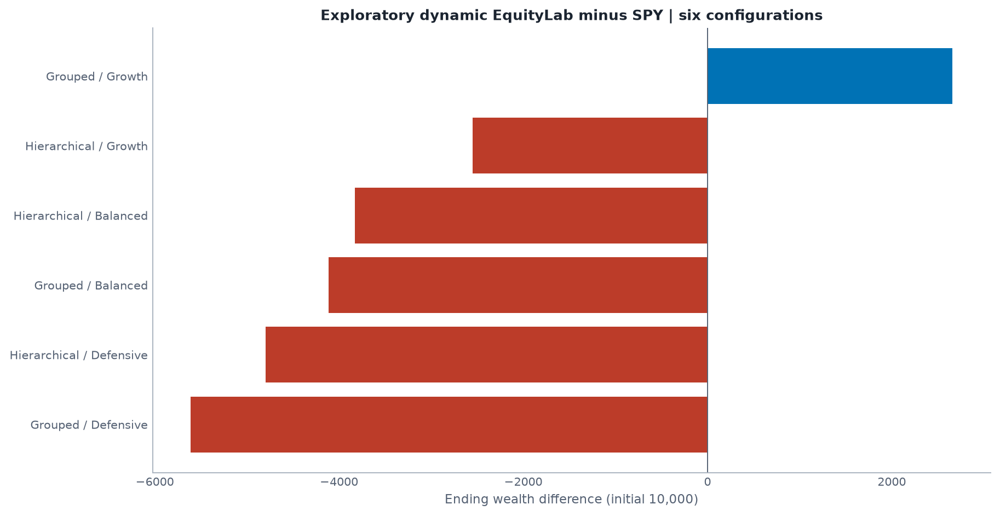

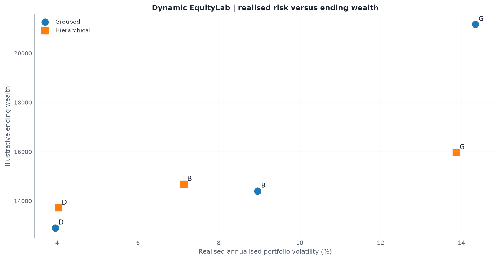

| Representation | Mandate | State-space | Control | SPY | SPY/T-bills | Exact-risk MPT† | State-space Sharpe |
|---|---|---:|---:|---:|---:|---:|---:|
| Grouped | Growth | 21,175 | 17,020 | 18,516 | 18,516 | 15,881 | 1.50 |
| Grouped | Balanced | 14,405 | 13,542 | 18,516 | 17,111 | 13,267 | 0.87 |
| Grouped | Defensive | 12,905 | 13,022 | 18,516 | 13,351 | 12,569 | 0.96 |
| Hierarchical | Growth | 15,968 | 17,509 | 18,516 | 18,516 | 17,696 | 0.85 |
| Hierarchical | Balanced | 14,685 | 13,749 | 18,516 | 17,111 | 12,630 | 1.17 |
| Hierarchical | Defensive | 13,717 | 14,021 | 18,516 | 13,351 | 12,802 | 1.46 |

† This MPT control matches the **historical-mean control** ex-ante risk, NOT the dynamic portfolio risk. A like-for-like risk-matched dynamic MPT comparison is not established. Dynamic Sharpe uses the monthly T-bill excess return and is for descriptive analysis.

<!-- DYNAMIC_ALL_COMPARISONS_END -->

</details>

<details>
<summary>All six configurations: monthly wealth and drawdown charts</summary>

Each chart shows both dynamic candidates, the historical-mean control and the benchmarks on the same 36 dates. Risk-matched MPT is matched to the control only.

<!-- MONTHLY_WEALTH_CHARTS_START -->
**Grouped / Growth**


**Grouped / Balanced**

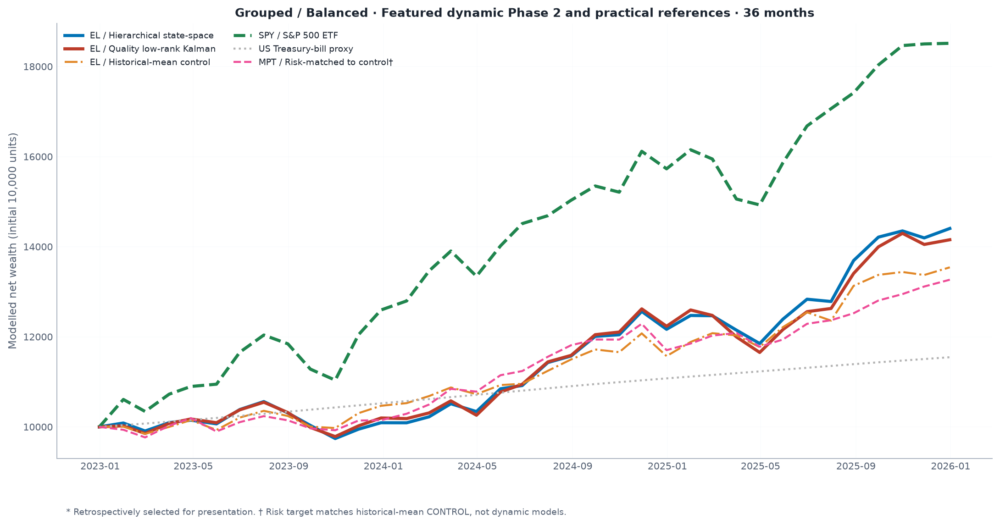

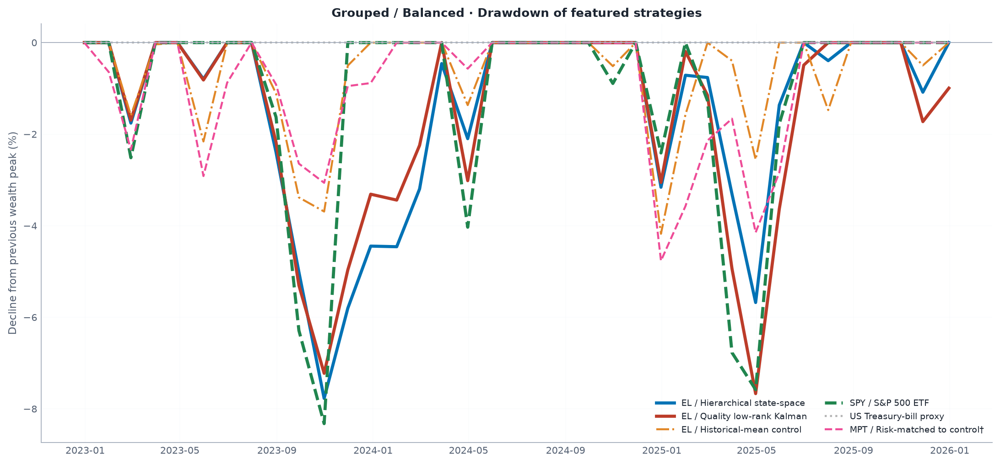

**Grouped / Defensive**

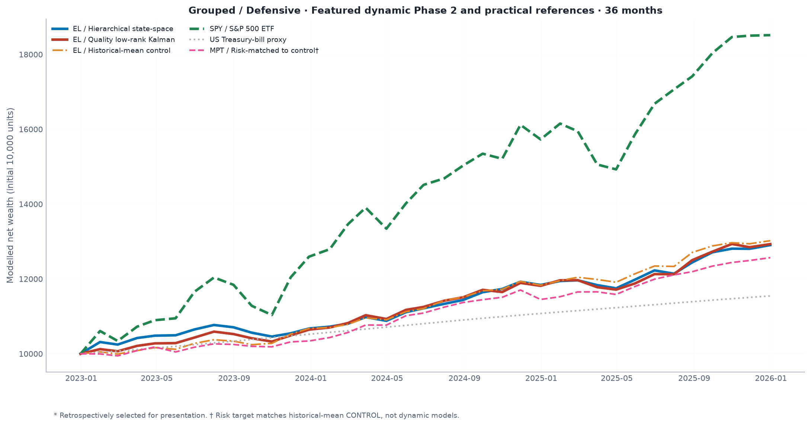

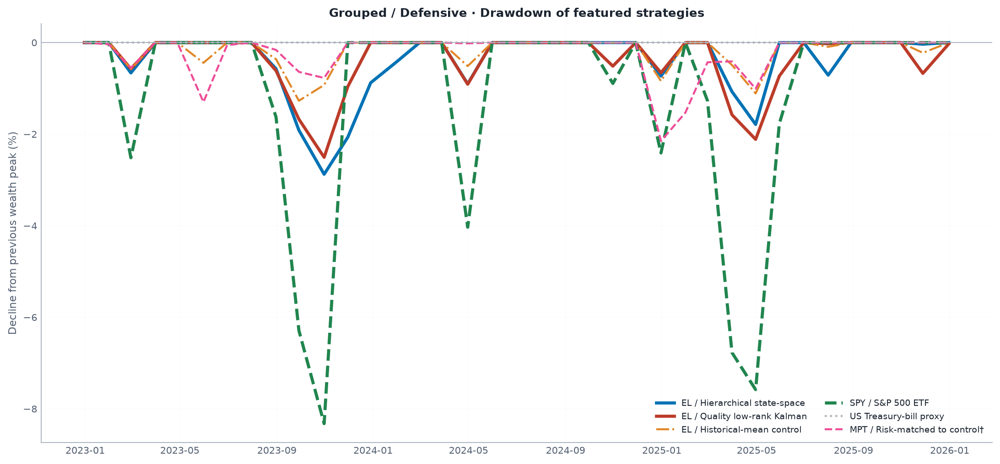

**Hierarchical / Growth**

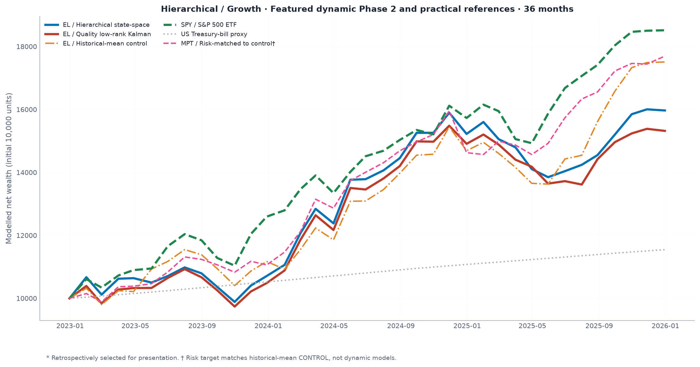

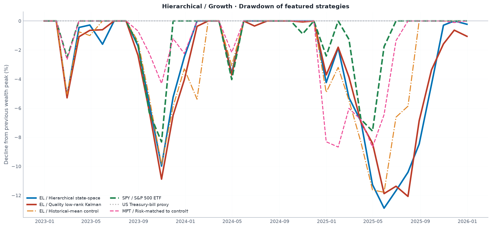

**Hierarchical / Balanced**

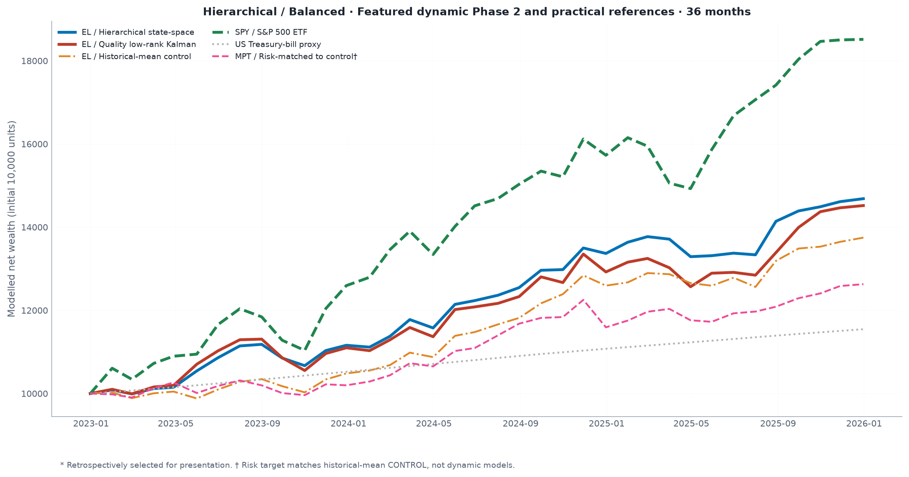

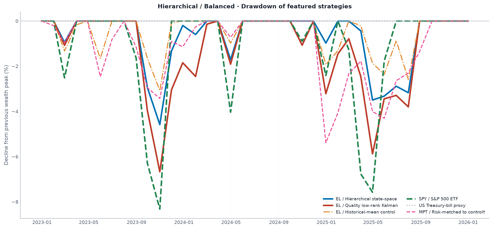

**Hierarchical / Defensive**

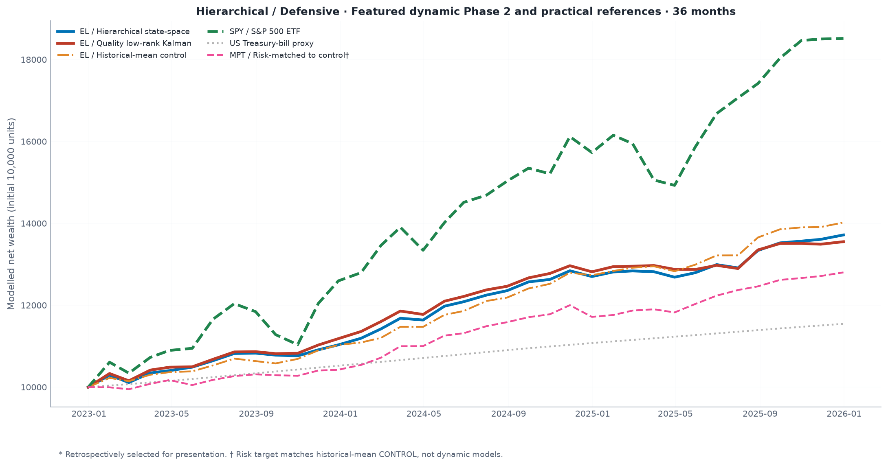

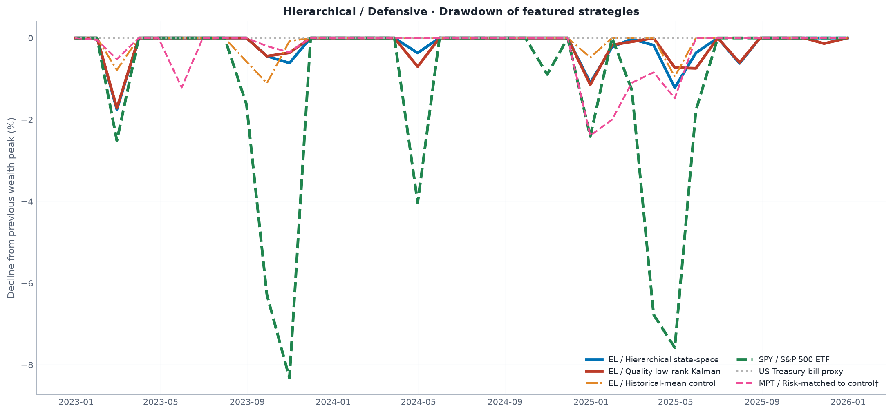
<!-- MONTHLY_WEALTH_CHARTS_END -->

</details>

### Does forecasting add value over the control?

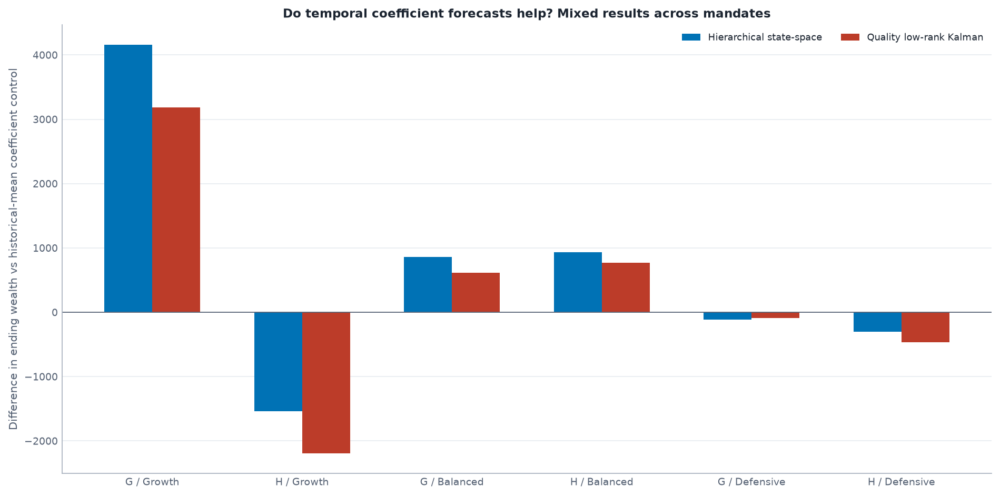

*Dynamic model minus the historical-mean control, within the same representation and mandate.*

Not consistently. The dynamic models finished ahead in 6 of 12 comparisons, including both Balanced configurations and Grouped Growth, and behind in both Defensive configurations and Hierarchical Growth. Only one monthly return difference has a HAC t-statistic above 1.96: state-space in Grouped Growth (t = 2.03), which is also the highlighted result.

### Market exposure

These tests ask how much of each return is explained by SPY exposure:

$$
R_{EL,t}-R_{f,t} = \alpha + \beta(R_{SPY,t}-R_{f,t}) + \varepsilon_t
$$

Here $R_f$ is the monthly T-bill proxy, and the intervals use Newey–West errors with three lags.

- **Grouped Growth state-space:** estimated alpha is **5.9% a year**, with a 95% interval of **−4.0% to +15.8%**, so a true value of zero is plausible.
- **Dynamic models overall:** none of the 12 intervals sits above zero. The largest t-statistic is 1.61.
- **Historical-mean control:** Hierarchical Defensive is the only one of all 18 strategies with an interval above zero (t = 2.71, 0.9% to 5.7% a year). One such result across 18 tests needs a fresh sample before it can be trusted.
- **Same-volatility comparison:** a constant SPY/T-bill mix was matched to each portfolio's realised volatility. The four dynamic Growth portfolios were more volatile than SPY, so no unlevered match exists. Of the other eight, one ended above its mix.

Alpha here is residual return under this one-factor model only, and other factor exposures are not removed.

<!-- MARKET_DIAGNOSTICS_START -->

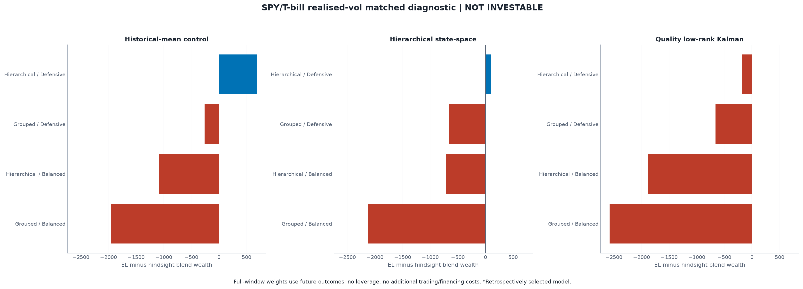

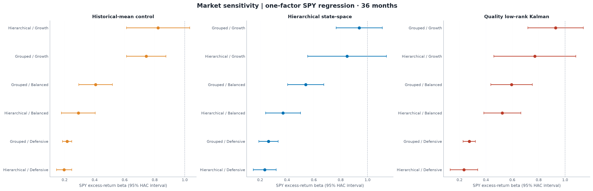

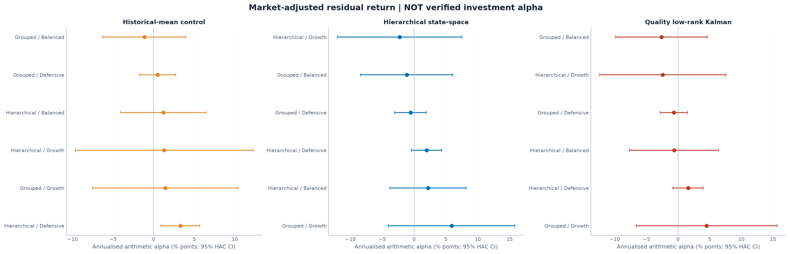

The blend uses a constant **full-sample hindsight** weight, constrained to 0–100% SPY, to match realised volatility. This is **not an investable strategy**; infeasible targets are explicitly recorded as `unattainable_unlevered`. The regression uses monthly portfolio returns above the monthly T-bill proxy and a one-factor SPY excess-return benchmark. The intercept is an *estimated* residual return, not proof of causal alpha. HAC standard errors (Newey–West, 3 lags) give rough uncertainty intervals with only 36 observations; model selection and multiple testing remain concerns. Both featured dynamic candidates are selected retrospectively for presentation; neither is a prospectively validated H1 policy.

[Inspect the complete numeric audit](results/public_market_exposure_diagnostics.csv).

<!-- MARKET_DIAGNOSTICS_END -->

### Results without NVDA

The full pipeline, Phase 1 included, was rerun on the other 43 instruments, so the coefficients carry nothing learned from NVDA. SPY itself is unchanged.

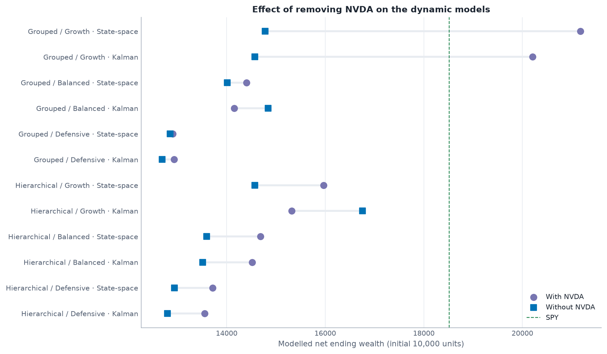

*Each row is one dynamic result. The dashed line is SPY's ending wealth.*

Ten of the 12 dynamic results fall, and the two Grouped Growth models fall the most. Two Kalman results rise: Grouped Balanced and Hierarchical Growth. No dynamic result stays above SPY.

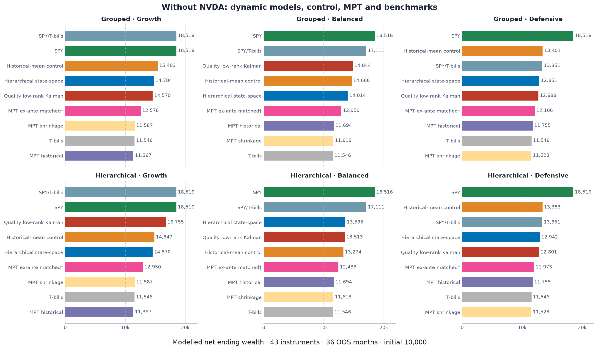

*The same ranking as above, on 43 instruments. † MPT matched to the control's estimated risk.*

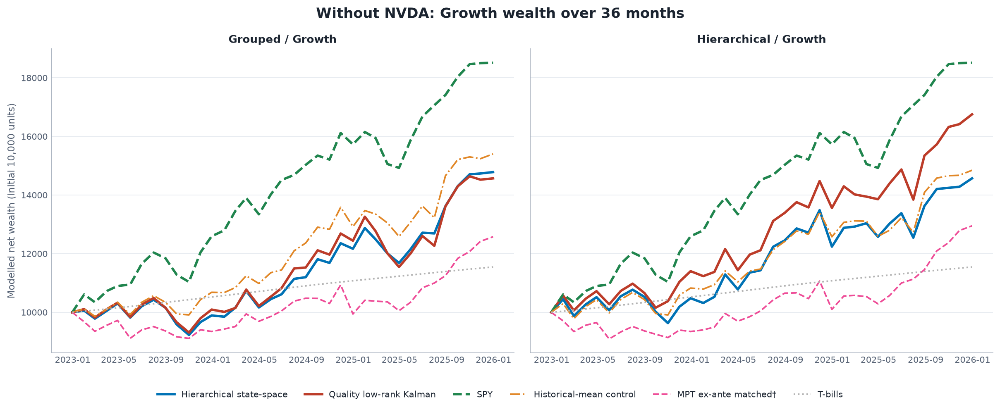

Against MPT, the lead widens in six of the eight comparisons that are complete in both runs, because MPT matched to the same risk falls too:

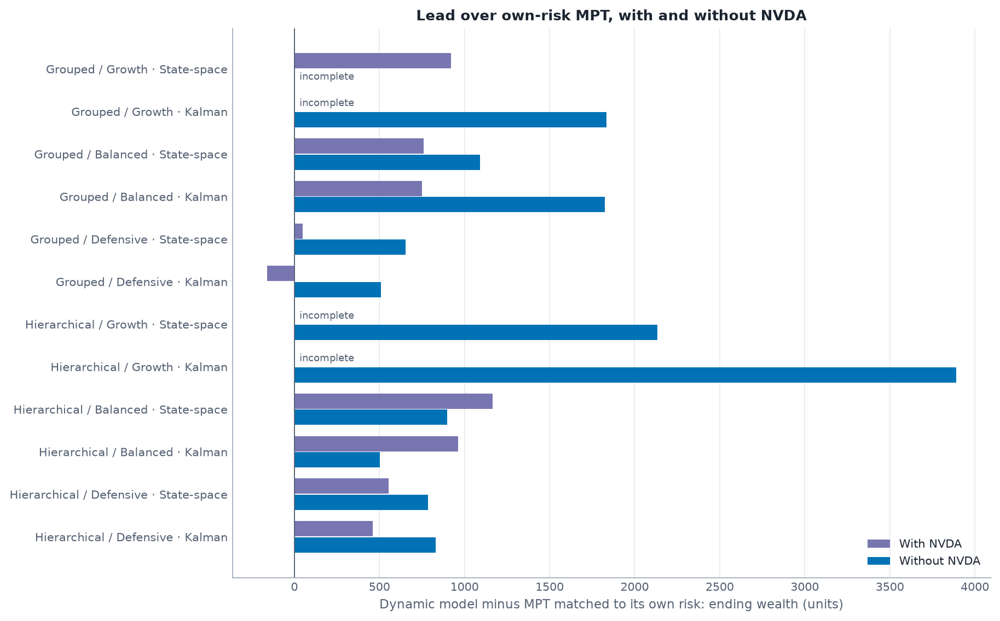

*Positive bars mean the dynamic model finished ahead of MPT matched to its own estimated risk. Incomplete paths had solver failures and are not counted.*

The [monthly results](results/without_nvda_monthly_net_wealth.csv) and [summary table](results/nvda_and_own_risk_robustness.csv) are released.

### Historical-mean control against MPT

These comparisons use the non-dynamic control, not the intended system.

| Mandate (Grouped) | Control | MPT / Historical mean | MPT / Shrinkage | SPY/T-bills |
|---|---:|---:|---:|---:|
| Growth | **17,020** | 11,545 | 11,568 | 18,516 |
| Balanced | **13,542** | 12,358 | 11,602 | 17,111 |
| Defensive | **13,022** | 12,497 | 11,657 | 13,351 |

The control beats both conventional MPT variants in all six public configurations, but these are not equal-risk comparisons. It also lags the SPY/T-bill blend in all three Grouped mandates. The blend is a simple mandate mix, not an exact-risk- or equity-exposure-matched benchmark.

The equity gap is large, which is why the risk-matched test below matters:

| Mandate | Control, Grouped | Control, Hierarchical | MPT / Historical mean |
|---|---:|---:|---:|
| Growth | 92.9% | 95.8% | 70.0% |
| Balanced | 61.9% | 43.1% | 30.0% |
| Defensive | 26.3% | 24.7% | 13.9% |

*Mean equity allocation across decision periods. Dynamic candidates are not shown.*

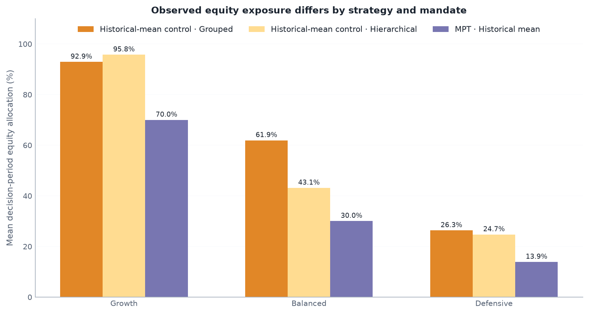

Constraining MPT to the control's estimated volatility at each decision narrows the gap considerably:

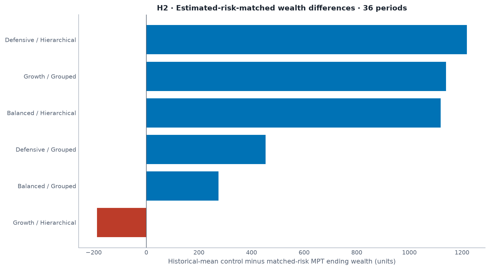

| Configuration | Control | Risk-matched MPT† | Difference |
|---|---:|---:|---:|
| Grouped / Growth | 17,020 | 15,881 | +1,140 |
| Grouped / Balanced | 13,542 | 13,267 | +275 |
| Grouped / Defensive | 13,022 | 12,569 | +454 |
| Hierarchical / Growth | 17,509 | **17,696** | **−187** |
| Hierarchical / Balanced | 13,749 | 12,630 | +1,119 |
| Hierarchical / Defensive | 14,021 | 12,802 | +1,218 |

- **Exception:** Hierarchical Growth reverses the result on wealth and Sharpe (1.08 against 1.35 for MPT).
- **Significance:** only Hierarchical Defensive has a paired HAC t-statistic above 1.96. The six comparisons are closely related, so they are not six independent confirmations.
- **Realised risk:** the control's realised volatility still differs from matched MPT's, because matching applies to forecasts.
- **Solver:** the matched MPT problem is nonconvex, so its solutions are feasible but not certified as globally optimal.

### H3: EquityLab information inside MPT

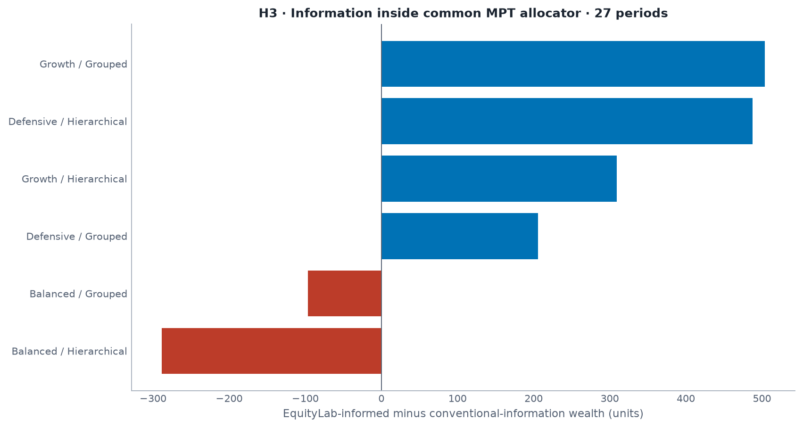

This separate 27-month experiment gives one MPT optimiser either conventional return inputs or EquityLab-derived information. EquityLab information improved ending wealth in 4 of 6 configurations and hurt in both Balanced configurations. It does not test the complete EquityLab strategy.

### Formal hypothesis tests

[The test report](results/statistical_testing/hypothesis_testing_report.md) runs paired one-sided tests on the dated monthly net returns, with Newey–West errors, block-bootstrap intervals and a Holm correction within each family:

| Family | Tests | p < 0.05 | After Holm correction |
|---|---:|---:|---:|
| H1: dynamic models vs MPT matched to their own risk | 9 | 0 | 0 |
| H1: dynamic models vs conventional MPT | 24 | 13 | 4 |
| H2: dynamic models vs the historical-mean control | 12 | 1 | 0 |
| H3: EquityLab information inside MPT | 6 | 1 | 1 |

The direct H1 test finds no significant gap. That is inconclusive rather than negative: a paired t-statistic grows roughly as the annual information ratio × √years, so over three years only a ratio near 1.1 would clear 1.96. Good active strategies typically run at 0.3–0.7, and a ratio of 0.5 would need about 15 years. The four conventional-MPT results that survive correction are Grouped Growth (state-space vs both MPT variants) and Hierarchical Defensive (both models vs MPT / Shrinkage), and conventional MPT took less risk in those comparisons. A one-sided p below 0.05 means t above 1.645, a lower bar than the t above 1.96 used for "clearly above zero" elsewhere in this README, which is why 13 here and 9 above differ. The models were chosen after seeing these results, so all p-values are exploratory. [The method note](docs/STATISTICAL_HYPOTHESIS_TESTING.md) gives the definitions.

### Portfolio breadth

These charts cover the **hierarchical state-space** portfolios. They count positions of at least 0.5% and show monthly additions and removals.

<!-- ALLOCATION_CHARTS_START -->
<!-- ALLOCATION_CHARTS_END -->

<!-- COMPOSITION_FIGURES_START -->
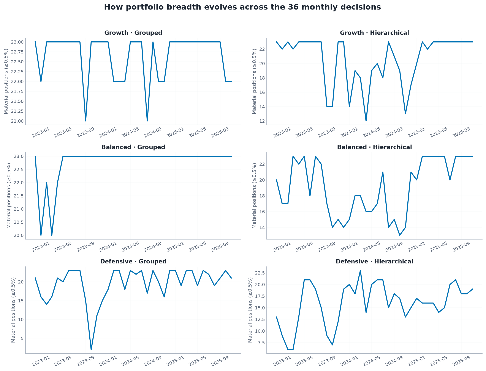

*Selected portfolio breadth over time; a 0.5% minimum position size defines a material asset.*

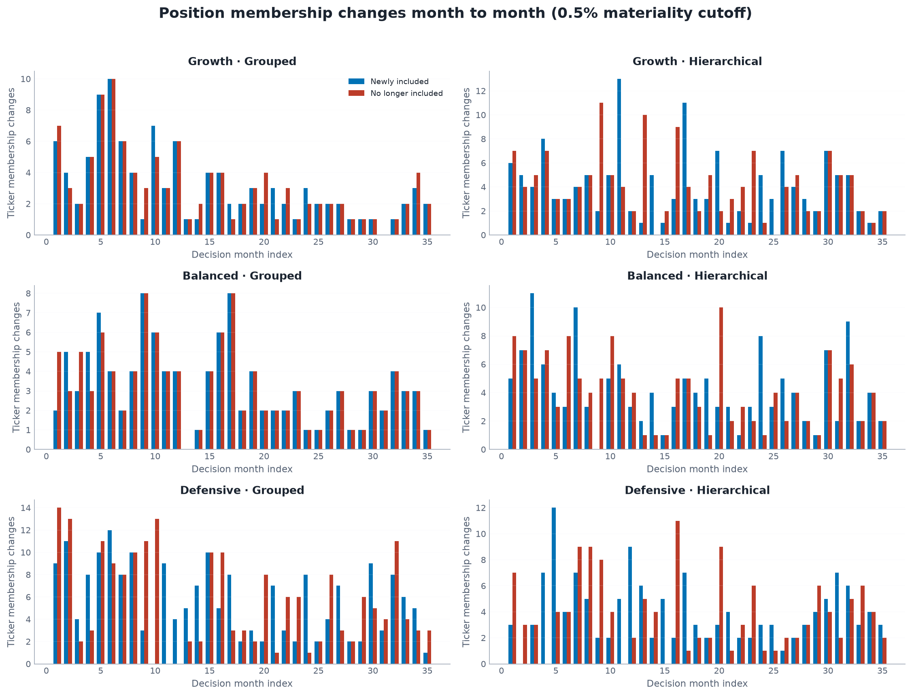

*Monthly membership additions and removals; this is NOT turnover by traded value.*

*Security names and position weights are not published.*

<!-- COMPOSITION_FIGURES_END -->

## Asset universe

The EquityLab portfolios and MPT in the 36-month evaluation draw on a fixed list of **44 instruments**, available at every monthly decision:

| Group | Count | Role |
|---|---:|---|
| Large-cap US stocks | 31 | Single-stock positions across sectors |
| US sector ETFs | 11 | Broad sector exposure |
| SPY | 1 | Market exposure and benchmark |
| Treasury-bill instrument | 1 | Cash and defensive allocation |

The EquityLab portfolios held at most 23 positions of 0.5% or more. The complete list and its weights are not published.

**How the list was chosen:** by hand, not by a rule. It is a pilot sample of large, well-known US companies, with two to four stocks in each of the 11 sectors, and it includes a five-stock mega-cap group that contains NVDA. The choice was also limited by data. Everything came from free sources, such as SEC EDGAR filings and free market-price feeds, so a company needed usable public price and filing data. Historical index membership and market capitalisation were not available, so the list could not be rebuilt as it stood at each past date.

**Why this matters:** this is a convenience sample, not a historical record of what an investor could have chosen from at each date.

- **Survivorship:** membership is not verified as point-in-time. Companies that are large today may be included because they did well, which would flatter any strategy allowed to hold them.
- **Concentration:** with 31 stocks, a few large winners can drive results. NVDA alone accounts for the Growth lead over SPY, as the [rerun without it](#the-main-result) shows.
- **Narrow breadth:** SPY holds about 500 companies, so a gap against SPY or MPT may reflect the list as much as the method.

These results therefore show what happened within this list, and do not show how the strategy would perform on a broader, historically accurate universe.

## Data and limitations

The private pipeline combines a dated investable asset panel, market and T-bill returns, economic inputs, and a portfolio and transaction-cost ledger. This repository publishes portfolio-level outputs only, with no private code, holdings, scores or coefficients. The only stock named is NVDA, disclosed because of the robustness test above.

- **Short sample:** 36 months for H1 and H2, and 27 for H3, in a strong period for US equities.
- **Fixed universe:** see [Asset universe](#asset-universe). Survivorship bias has not been ruled out.
- **Selection:** the featured models were chosen with hindsight, and no prospective model-selection rule exists.
- **Point-in-time data:** publication dates and data vintages are not fully verified, so look-ahead effects cannot be ruled out.
- **Currency:** the archived report uses sterling labels, but the FX conversion is unverified. Treat values as illustrative units.
- **Implementation:** costs are modelled. Market impact, capacity and taxes are not established, and nothing here is an audited trading record.
- **Correlated tests:** configurations share the same calendar, so win counts are not independent evidence.

See [limitations](docs/limitations.md) and [data provenance](docs/data_and_provenance.md) for detail.

## Reproducing the public results

The tables and figures can be rebuilt from the released CSVs. The private strategy itself cannot be rerun from this repository.

```bash
python -m pip install -r requirements.txt
python analysis/generate_public_figures.py
python analysis/research_hypothesis_inference.py
python -m unittest discover -s tests
```

## Next steps

1. Rebuild the universe from point-in-time membership, and test sensitivity to other large holdings.
2. Resolve the solver failures in the incomplete own-risk MPT paths.
3. Verify publication dates, total-return handling and FX conventions at source.
4. Freeze a model-selection rule, then test it on untouched data.
5. Improve exposure attribution, capacity and transaction-cost estimates.
6. Test whether news adds information, once the steps above are done.

**Planned extension: LLM analysis of news.** The aim is to use a large language model (LLM) to turn time-stamped financial news into structured features, such as event type, affected industry or asset, direction, intensity and whether the event was a surprise. Those features could help the dynamic models respond to abrupt changes that smooth historical coefficients adapt to slowly. The test would compare dynamic models with and without news on identical dates and mandates, using only news that was available at each decision. This is planned research, with [nothing implemented or validated yet](docs/future_research_roadmap.md), and no reported result uses news.

## Explore the work

- [Public notebook](notebooks/01_public_readout.ipynb): recomputes the main tests from released data
- [Research brief](docs/research_brief.md)
- [Public methodology](docs/methodology_public.md)
- [Selected findings](docs/selected_findings.md)
- [Limitations and open questions](docs/limitations.md)
- [Data provenance and verification gaps](docs/data_and_provenance.md)
- [Released results](results/) and [figure generation](analysis/generate_public_figures.py)

**For interested researchers or hiring teams:** I can discuss the experimental choices, numerical implementation, risk-matching design and lessons from adverse results in more detail, without releasing the proprietary strategy.
