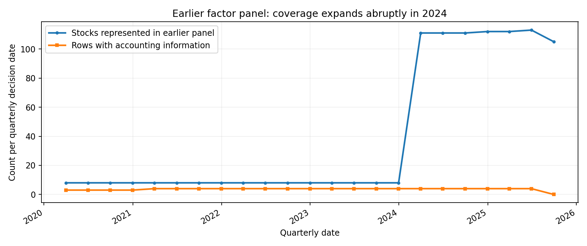
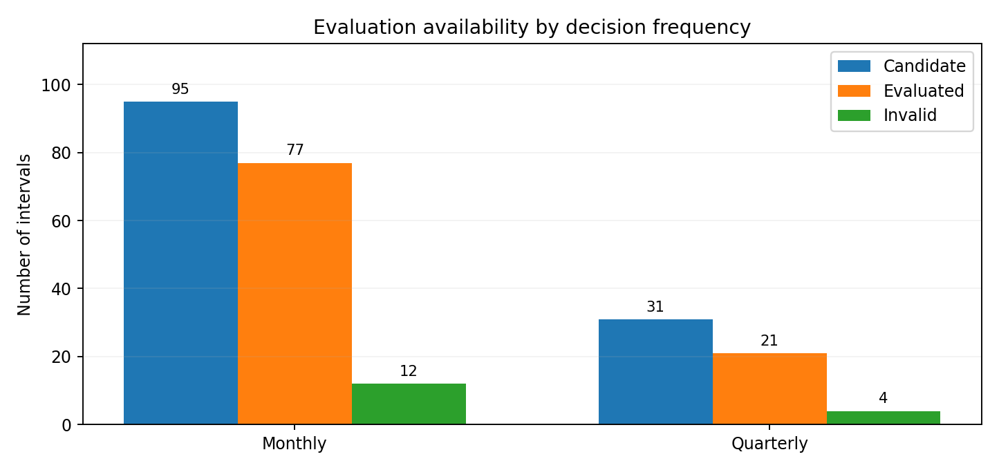
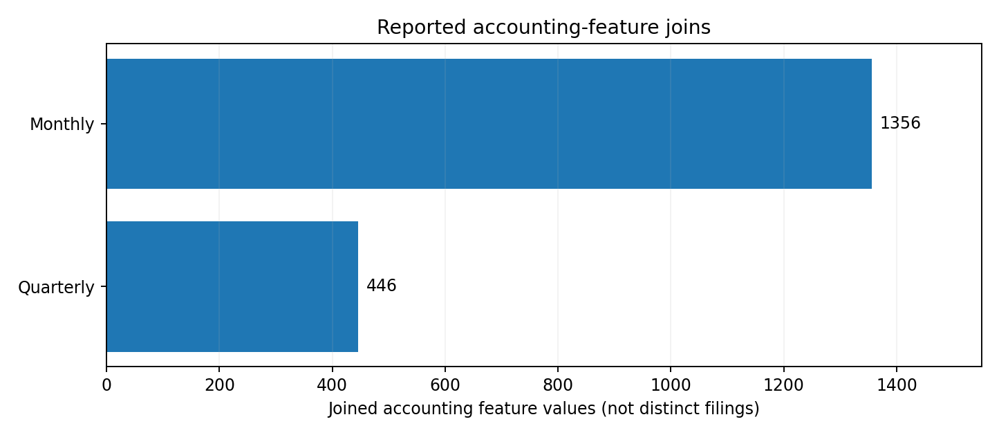
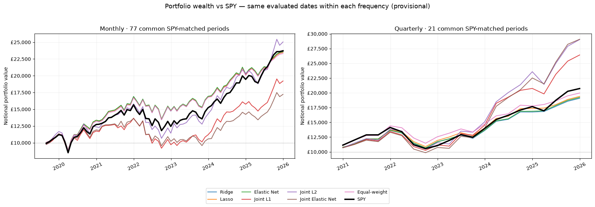
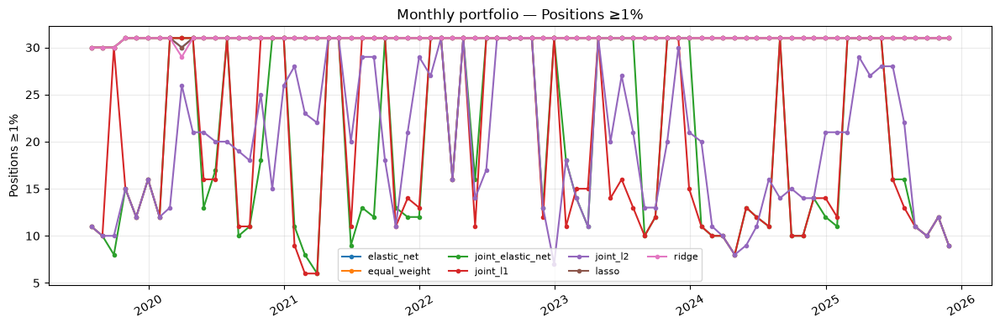
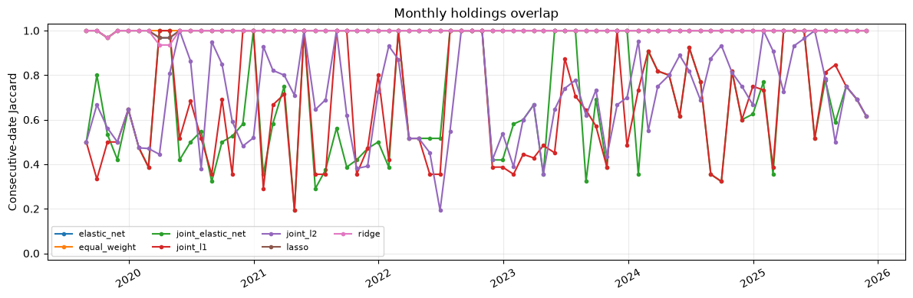
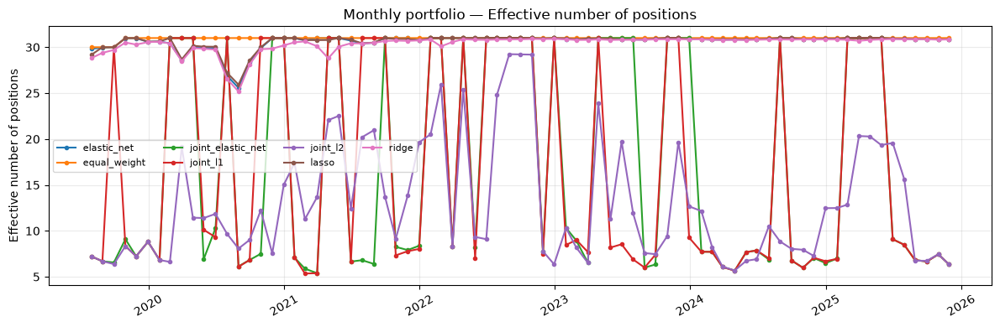
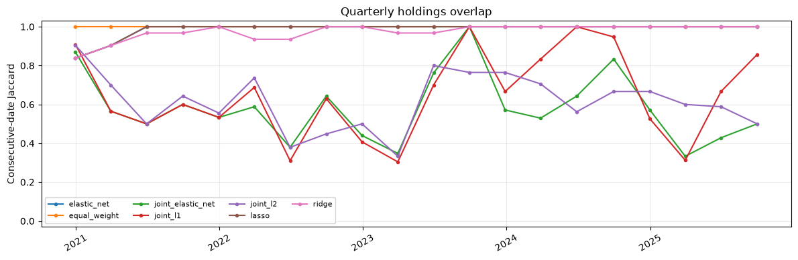
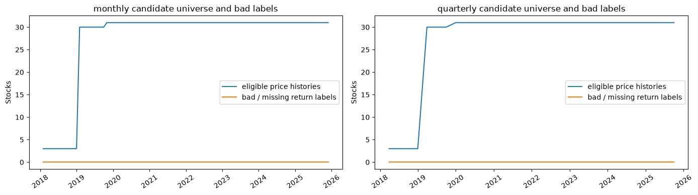

# EquityLab — Public Research Showcase

**Historical portfolio construction, chronological evaluation and transparent limitations.**

> **Research status: `EXPLORATORY_ONLY`.** This is a presentation of exploratory backtests, not evidence of live performance or validated alpha. The private model implementation, raw datasets and exact optimisation settings are not distributed.

## Research question

Can a portfolio-allocation policy learned **jointly from multiple completed historical periods** improve net portfolio outcomes compared with regularised regression-based allocation, simple equal weight, and SPY? The research considers **monthly and quarterly** portfolio decisions, with long-only position constraints and illustrative transaction costs.

## Data sources and coverage

This showcase is supported by historical equity **adjusted daily price records**, a locally cached **SPY benchmark**, and a more sparsely populated set of **dated accounting features**. The wider private project has SEC-oriented company-financial acquisition and Tiingo/FRED/ALFRED provider integrations; this does **not** mean every source is used in the plotted strategies. See the [data sources and coverage report](docs/data_sources_and_coverage.md) for source roles, quality checks and what is still unverified.

| Data inventory (reported local audit) | Value | Interpretation |
| --- | ---: | --- |
| Daily-price candidate universe | **31 stocks** | Stocks with selected compatible daily histories, not a certified historical investable universe |
| Adjusted-price rows / source series | **74,592 / 36** | Aggregate cached price inventory; individual ticker histories vary |
| Aggregate price-date extent | 2005-01-03 to 2026-10-23 | Earliest and latest observations across sources, not the evaluation period |
| Earlier quarterly factor panel | **113 stocks / 903 rows** | A **different** historical dataset and stock cohort |
| Monthly evaluated intervals | **77** | July 2019 to December 2025, subject to research exclusions |
| Quarterly evaluated intervals | **21** | September 2020 to December 2025, a different starting window |
| Joined dated accounting values | **1,356 monthly / 446 quarterly** | Feature-date joins; **not** unique filings or evidence of complete coverage |
| Legacy extreme return labels awaiting reconstruction | **6** | Still unresolved; not used as verified evidence |

### Data availability and cohort changes



*The earlier quarterly panel represented just eight stocks on dates before 2024, then more than 100 as data coverage expanded. This is a **dataset composition discontinuity**, not a market-wide listing event.*

| Evaluation interval availability | Accounting feature-value joins |
|:--:|:--:|
|  |  |

The additional financial values reflect point-in-time joining attempts, not independently verified new filings. Some financial ratios are available for only a minority of stock-date observations; the market features are substantially more complete. These limitations make market-only versus combined-feature ablations essential next work.

The public [data inventory CSV](results/data_inventory_summary.csv) and [historical panel coverage CSV](results/historical_panel_coverage.csv) support the summary without releasing proprietary ticker-level datasets.

## Portfolio results against SPY



*Saved exploratory experiment output. Initial notional: 10,000 currency units, labelled £10,000 in the original analysis; FX conversion and real-world GBP execution were not fully modelled. Within each frequency, strategies and SPY use matched evaluation periods. **Monthly and quarterly cover different calendar windows and should not be compared as an isolated frequency effect.***

### Aggregate results

| Strategy | Monthly ending notional | Quarterly ending notional |
|:--|--:|--:|
| SPY | 23,724 | 20,731 |
| Equal-weight | 23,314 | 19,967 |
| Ridge | 23,538 | 19,077 |
| Lasso | 23,482 | 19,394 |
| Elastic Net | 23,625 | 19,230 |
| Joint L1 | 19,221 | 26,419 |
| **Joint L2** | **25,045** | **29,036** |
| **Joint Elastic Net** | **17,224** | **29,080** |

The monthly comparison spans **77 matched holding periods** (July 2019–December 2025); the quarterly comparison **21** (September 2020–December 2025). Amounts are rounded from saved notebook outputs and use the same starting notional. They are **not audited investment returns**. See [`results/aggregate_strategy_summary.csv`](results/aggregate_strategy_summary.csv) for all aggregate strategy results and reported turnover.

The direct policies show very different outcomes across penalties and frequencies. This is a research finding about **sensitivity**, not evidence that a winning variant will generalise.

## Portfolio composition and stability

| Monthly positions with at least 1% allocation | Monthly consecutive-date holdings overlap |
|:--:|:--:|
|  |  |

| Quarterly positions with at least 1% allocation | Quarterly consecutive-date holdings overlap |
|:--:|:--:|
|  |  |

The overlap charts use *Jaccard similarity of selected tickers at consecutive dates*. A model can be fully invested in many tiny positions, so a minimum 1% threshold is used when displaying meaningful portfolio size. The detailed trade lists, weights and exact feature-selection settings remain private.

## Daily-price candidate availability



This chart concerns the **31-stock daily-price experiment**, not the 113-stock legacy quarterly panel shown earlier. Neither universe is point-in-time certified.

## Explore the evidence

| Public resource | Content |
|:--|:--|
| [01 — Research overview](notebooks/01_research_overview.ipynb) | Self-contained figures, aggregate performance table and limitations |
| [02 — Portfolio analysis](notebooks/02_portfolio_analysis.ipynb) | Portfolio composition, overlap and dataset diagnostics |
| [Data sources and coverage](docs/data_sources_and_coverage.md) | Providers, inventory, data availability, joins, cohort discrepancy and unresolved audits |
| [Data inventory CSV](results/data_inventory_summary.csv) | Audit numbers with evidence labels; no private security records |
| [Historical panel coverage CSV](results/historical_panel_coverage.csv) | Aggregate decision-date counts without individual holdings |
| [Methodology](docs/methodology.md) | High-level research design and chronological controls |
| [Limitations](docs/limitations.md) | Detailed reasons results remain exploratory |
| [Aggregate results CSV](results/aggregate_strategy_summary.csv) | Small reviewed, aggregate table; no individual holdings or model parameters |

The notebooks **run without access to the private modelling scripts**. They load only the included images and aggregate CSV and do not recompute backtests. That is a disclosure choice and means the published notebook is **not a fully reproducible investment experiment**.

## What is public, and what is not

Public: the research question, high-level methodology, aggregate evaluation tables, representative figures and known failure modes. Private: model-source implementation, detailed optimisation objective/settings, company-level features, holdings histories, proprietary research code and raw datasets.

## Local viewing

```bash
python -m pip install jupyterlab pandas matplotlib
jupyter lab
```

Open the notebooks from this repository directory. No market-data credentials are needed to view the saved analysis.

## Licence

Original materials: **All rights reserved**. See [LICENSE](LICENSE). Third-party rights remain with their respective owners. Nothing herein constitutes investment advice.
