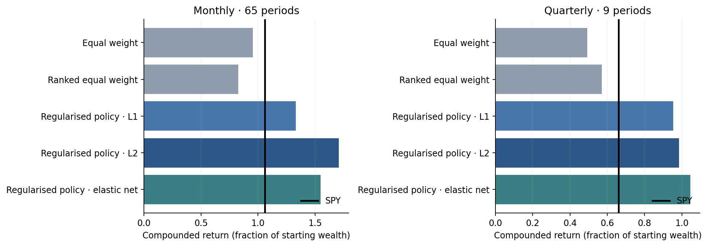
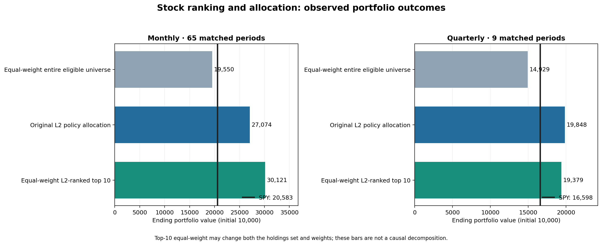
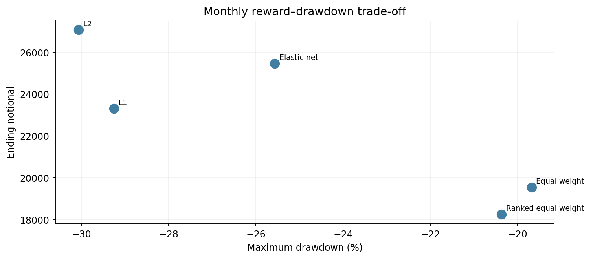

# Portfolio construction and economic attribution

## Matched historical portfolio outcomes

The public portfolio-policy evaluation covers 65 monthly periods (July 2020–December 2025) and nine quarterly periods (September 2023–December 2025). All values below assume an illustrative initial notional of 10,000. Historical strategy return endpoints are matched with SPY **within each frequency**.

| Portfolio approach | Monthly terminal | Monthly max drawdown | Quarterly terminal | Quarterly max drawdown |
| --- | ---: | ---: | ---: | ---: |
| Equal-weight universe | 19,550 | −19.7% | 14,929 | −0.8% |
| Simple ranked equal-weight selection | 18,261 | −20.4% | 15,706 | −3.1% |
| Regularised L1 policy | 23,316 | −29.3% | 19,532 | −5.2% |
| Regularised L2 policy | **27,074** | −30.1% | 19,848 | −4.2% |
| Regularised elastic-net policy | 25,466 | −25.6% | **20,449** | −5.1% |
| SPY | 20,583 | — | 16,598 | — |

Drawdowns for SPY are omitted where the selected portfolio summary did not export a benchmark drawdown in the same table. Quarterly drawdowns span only nine intervals and materially understate longer-horizon risk.

## Stock ranking versus allocation: interpreting the comparison

The monthly 65-period comparison evaluates **three different construction choices**: equal-weighting every eligible stock (19,550 ending value), the original L2-weighted portfolio (27,074), and equal-weighting the L2-ranked top ten (30,121). SPY ended at 20,583 over the same months. Ending wealth begins from an illustrative 10,000.

The ranked top-ten portfolio had a higher average reported turnover (**34.8%**) than the original L2 allocation (**23.9%**) and a maximum drawdown of **−27.3%**, versus **−30.1%** for the original allocation. On nine quarterly periods, **the original allocation ended higher** (19,848 versus 19,379).

**Interpretation:** This tests whether a simpler ranked-stock portfolio is economically competitive with the original policy. It is **not a pure test of sizing**: selecting exactly ten stocks can also change which securities are held. These historical differences are not causal return contributions and do not establish a future winning rule.

See [the step-by-step interpretation and illustrative example](selection_and_weighting_explained.md).

## Risk versus reward

The monthly L2 allocation generated a materially deeper drawdown than the universe equal-weight control. Higher compounded wealth cannot be presented without its accompanying risk and implementation burden.

## Numerical reliability

Saved solver metadata in the portfolio-policy evaluation report zero nonconverged fitted dates for the three regularised allocation families over 65 monthly and nine quarterly evaluations each. Reported coefficient magnitudes are nonzero; solver convergence alone does not demonstrate economic optimality, guarantee a global solution, or resolve data-selection bias. Simpler equal-weight controls have no fitted-solver convergence interpretation.

## Forecast-supported portfolio evaluation

A separate monthly matched-sample assessment includes **59 periods**, not 65. The top cited forecast-informed and temporally adjusted configuration ended at approximately **30,087**, compared with **29,915** for its simpler return-informed comparator and **18,578** for SPY. The additional terminal-notional difference is small relative to the extensive model search, and the compared methods were not all fitted under the same allocation engine. The separately available quarterly matched comparison spans only **three periods**, so it cannot support an investment conclusion.

The public materials do not disclose exact forecasts, security-level policies or how temporal adjustments are constructed. The aggregate comparison is provided to illustrate research trade-offs, not to claim an identifiable incremental alpha mechanism.

## Interpretation

The appropriate decision is **investigate further**, not deploy. Stronger point-in-time histories, broader security representation, cleaner execution modelling and independent confirmation would be required before any capital-allocation claim.

## Historical wealth trajectories

Actual dated performance charts are provided in the repository [README](../README.md#historical-performance-through-time) and [public performance notebook](../notebooks/01_portfolio_evidence.ipynb). These are figure exports, not a public security-level dataset. Note that portfolio-policy and forecasting/allocation cohorts are different.
