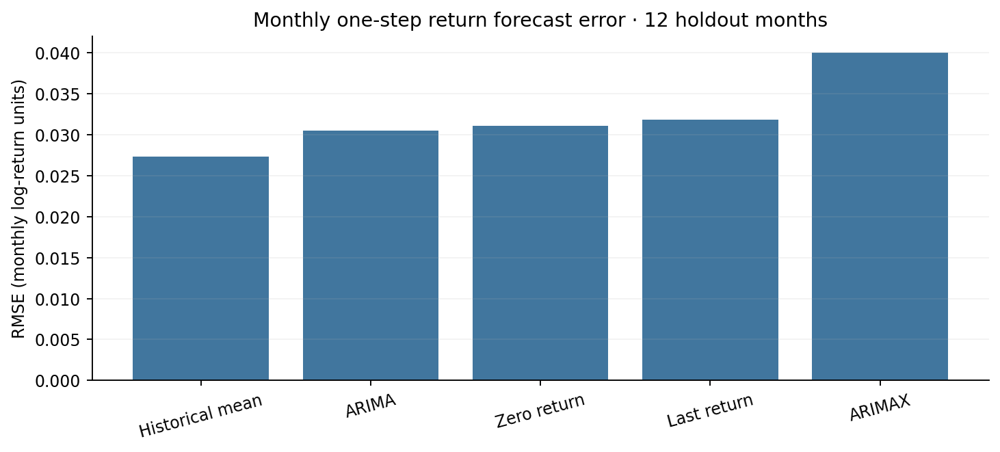
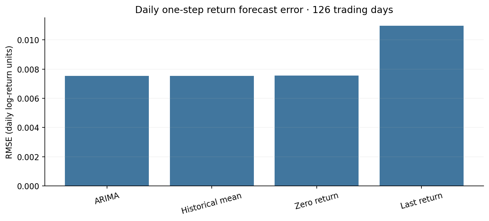
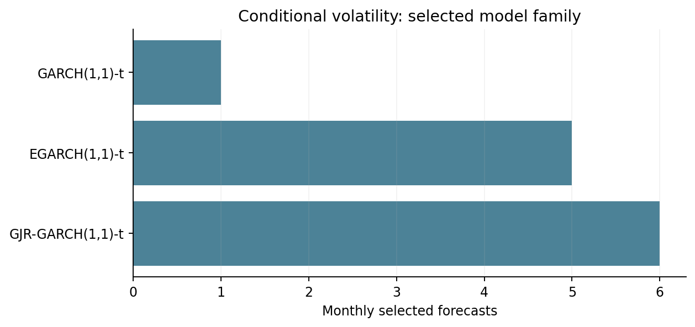

# Historical returns, time-series forecasting and conditional volatility

## Statistical questions

The research examines (1) the empirical distribution of realised returns; (2) linear serial dependence in returns; (3) dependence in squared returns; (4) the predictive value of autoregressive time-series models; and (5) the usefulness of time-varying conditional variance.

## Returns and scaling

The portfolio backtest compounds **simple** holding-period returns. Time-series models and diagnostics may use **log returns**, \(g_t=\log(1+R_t)\), provided the return convention is explicit. Log returns sum across intervals; simple returns compose multiplicatively. The two should not be mixed in portfolio wealth calculations.

## Historical SPY monthly diagnostics

The saved 65-observation monthly summary reports mean simple return approximately **1.21%**, annualised volatility **14.92%**, negative skewness (approximately **−0.61**), historical fifth-percentile simple return approximately **−5.79%**, and mean return in the worst five percent approximately **−7.97%**. These historical quantiles have high sampling uncertainty.

The saved tests report Ljung–Box p-value **0.284** for returns, **0.00059** for squared returns, and ARCH LM p-value **0.00203**. These indicate greater evidence of second-moment dependence than ordinary serial return dependence in this sample. They do not prove an exploitable trading signal or identify a unique volatility specification.

## One-step-ahead rolling forecast design

At each target observation \(t\), the model is selected and fitted using data through \(t-1\) and predicts **only** return \(r_t\). It then advances one observation. ACF/PACF and information criteria guide order selection using training-only history; candidate AR/MA/ARMA/ARIMA models are evaluated against fixed simple baselines. Optional lagged daily-market summaries enter monthly models only when known at the forecast origin.

| Monthly holdout (12 observations) | RMSE | MAE |
| --- | ---: | ---: |
| Historical mean | **0.027339** | **0.023681** |
| ARIMA | 0.030506 | 0.026788 |
| Zero-return forecast | 0.031078 | 0.026041 |
| Previous return | 0.031834 | 0.026255 |
| Daily-informed ARIMAX | 0.040059 | 0.032375 |

| Daily holdout (126 trading days) | RMSE |
| --- | ---: |
| ARIMA | **0.007529** |
| Historical mean | 0.007545 |
| Zero-return forecast | 0.007559 |
| Previous return | 0.010974 |

The tiny daily improvement in RMSE provides no persuasive evidence of meaningful return predictability. The daily and monthly evaluations have different dates, objectives and sampling frequencies.

## Conditional variance

Autocorrelation of squared returns and ARCH diagnostics motivate modelling volatility separately from the conditional mean. The report compares or selects among standard GARCH-family structures (including asymmetric specifications) when available, with exponentially weighted volatility as a simpler reference.

Across 12 monthly forecast dates, the saved selection counts were **six** for an asymmetric GJR-GARCH specification, **five** for EGARCH, and **one** for GARCH. These are selection counts, **not evidence of lower out-of-sample volatility forecast loss**. No comprehensive matched QLIKE or variance-MSE comparison is published; therefore a superiority claim would be premature.

## Limits

Short monthly samples yield noisy parameter estimates, weak statistical power and unstable model rankings. Predicted conditional standard deviation should not be expected to match the absolute size of each realised return. Volatility forecasting should ultimately be assessed with proper variance-specific scoring rules and independent testing.
