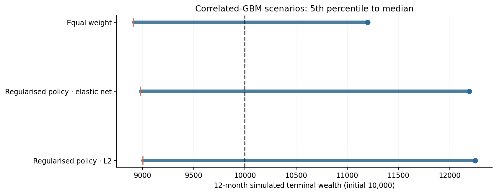

# Stochastic scenario analysis and portfolio downside

## Purpose

Scenario generation investigates the sensitivity of saved allocation snapshots to return covariance, market co-movement and tail behaviour. It is **not an independent validation of expected returns**: the scenarios inherit their calibration assumptions.

## Correlated geometric Brownian motion

A simplified continuous-time model is \(dS_i/S_i=\mu_i\,dt+\sigma_i\,dW_i\), with correlated Brownian shocks across assets and SPY. In simulations, a joint covariance estimate links equity paths; independent per-stock simulation would misstate common market risk.

## Historical block resampling

Block bootstrap scenarios jointly resample short historical sequences of stock and SPY returns to retain some observed cross-series and serial dependence. They cannot introduce market mechanisms entirely absent from the original observations.

## Illustration from saved portfolio snapshots

All simulated wealth figures below begin at 10,000, span 12 hypothetical months and hold the chosen strategy rule fixed for the scenario experiment. They are conditional outputs, not expected future investment profits.

| Portfolio snapshot | Correlated-GBM median | GBM fifth percentile | Joint-bootstrap median | Bootstrap fifth percentile |
| --- | ---: | ---: | ---: | ---: |
| Regularised L2 | 12,248 | 9,004 | 12,526 | 9,061 |
| Regularised elastic net | 12,190 | 8,981 | 12,479 | 9,026 |
| Equal-weight universe | 11,198 | 8,914 | 11,305 | 9,251 |

The selected portfolios had higher simulated median terminal wealth than the equal-weight comparator in these calibrations but also substantial downside risk. The output uses a historical holdings snapshot and does not reproduce full strategy retraining, daily execution or changing accounting features along synthetic paths.

## Risk measures

A scenario report examines median and downside terminal wealth, simulated drawdown and conditional SPY underperformance. A fifth-percentile outcome is a **model-based percentile**, not a confidence statement about future investment performance. Portfolio value at risk, expected shortfall and drawdown vary with covariance windows, expected-return assumptions and block selection.

## Interpretation

The defensible use is comparative **risk exploration**. Claims of robust real-market alpha require independent historical validation, not only many simulated trajectories.
